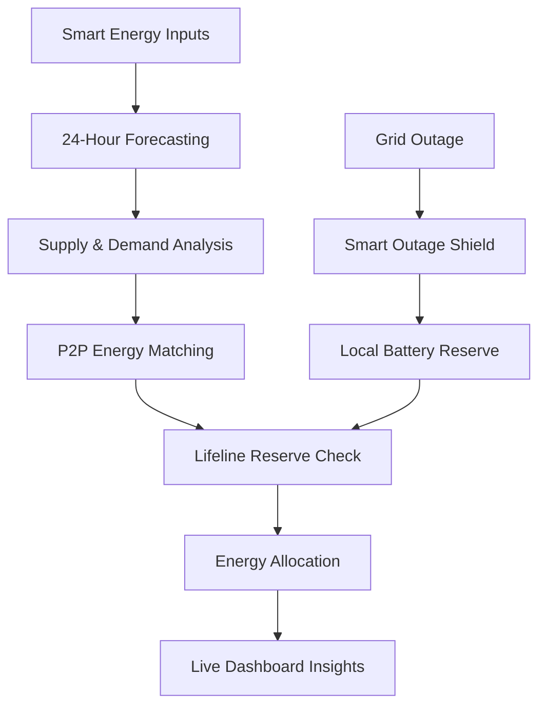
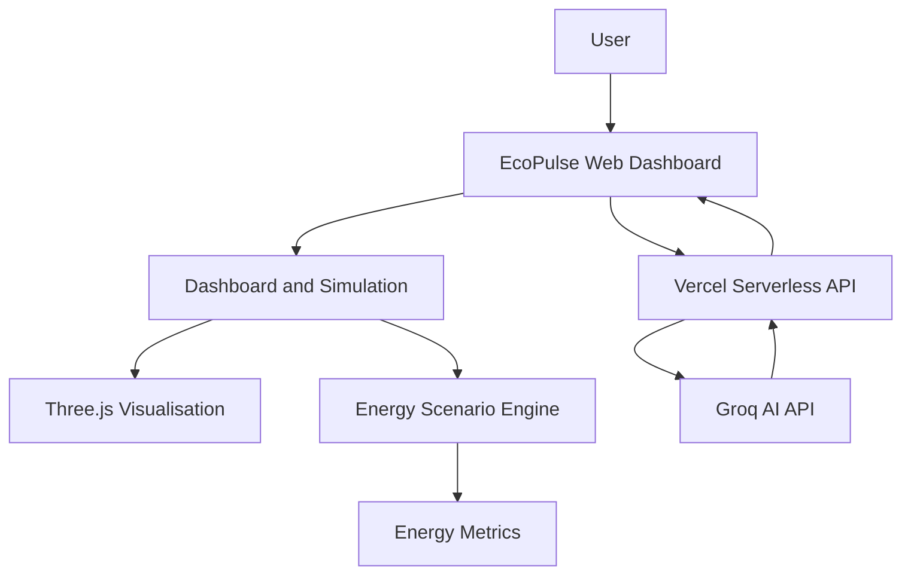
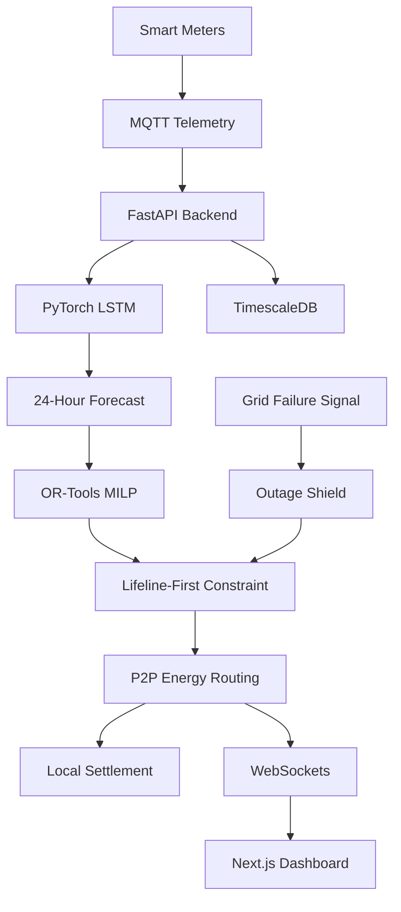

# ⚡ EcoPulse

> **The Intelligent Neighbourhood Energy Grid**
> *AI-Powered Peer-to-Peer Energy Coordination Platform with a 3D Energy Network and Lifeline-First Routing*
> *24-Hour Forecasting Concept · Neighbourhood Energy Routing · Smart Outage Shield · AI Energy Advisor*

---


**Live url:** [https://ecopulse-nu.vercel.app/]
**Repository:** [github.com/madhumitha9971-pixel/EcoPulse](https://github.com/madhumitha9971-pixel/EcoPulse)

---

## 👥 Team & Competition Details

- **Team Name:** Innovexa
- **Competition:** CODEQUEST 2026
- **Category:** AI & Sustainability
- **Author / Lead Developer:** D. Madhumitha
- **AI Core Engine:** Groq API (serverless endpoint at `/api/ai`)

> **Our promise:** *Trade fairly. Protect first. Power every neighbourhood.*

---

## 📌 Table of Contents

1. [Overview](#-overview)
2. [The Problem](#-the-problem)
3. [Our Solution](#-our-solution)
4. [The Innovation: Lifeline-First Routing](#-the-innovation-lifeline-first-routing)
5. [Key Features](#-key-features)
6. [How EcoPulse Works](#-how-ecopulse-works)
7. [System Architecture](#-system-architecture)
8. [Technology Stack](#-technology-stack)
9. [Why EcoPulse Is Different](#-why-ecopulse-is-different)
10. [Expected Impact](#-expected-impact)
11. [Demo Walkthrough](#-demo-walkthrough)
12. [Getting Started](#-getting-started)
13. [Deployment](#-deployment)
14. [Privacy & Responsible Design](#-privacy--responsible-design)
15. [Limitations & Roadmap](#-limitations--roadmap)
16. [Repository Structure](#-repository-structure)
17. [License](#-license)

---

## 🌍 Overview

Every afternoon, rooftop solar panels generate more electricity than some households can use. Every evening, the same neighbourhood faces peak demand and higher costs. Meanwhile, households that rely on powered medical equipment face real risk during unexpected outages.

The challenge is not only generating electricity. It is **how intelligently we distribute, prioritise and protect the energy we already have.**

EcoPulse is a neighbourhood-level energy coordination platform that forecasts demand, routes surplus renewable energy, and protects critical household reserves before any trading takes place.

---

## 🔴 The Problem

| Problem | Impact |
|---|---|
| ☀️ **Solar wastage** | Excess rooftop solar is not always used locally |
| ⚡ **Peak-hour pressure** | Evening demand increases grid congestion and cost |
| 🔌 **No local energy exchange** | Neighbours lack a coordinated way to share surplus energy |
| 🏥 **Critical power vulnerability** | Essential household energy needs may be affected by outages |

**Target users:** urban homeowners with rooftop solar, neighbourhood consumers seeking affordable electricity, households dependent on essential powered equipment, EV charging stations, and local utilities managing peak demand.

---

## 💡 Our Solution

EcoPulse combines energy forecasting, peer-to-peer coordination, intelligent allocation and emergency reserve prioritisation.

| Capability | Description |
|---|---|
| **24-Hour AI Energy Forecast** | Predicts neighbourhood supply and demand to identify shortages, surplus and peaks |
| **Automated P2P Energy Routing** | Matches surplus energy with nearby demand to maximise local renewable use |
| **Smart Outage Shield** | Demonstrates how local battery resources are prioritised during a grid failure |

Designed around three priorities: **Efficiency · Fairness · Human Safety**.

---

## 🛡️ The Innovation: Lifeline-First Routing

> **People before price.**

Conventional optimisation focuses on supply, demand and cost. EcoPulse adds a **protected reserve requirement** for households that voluntarily opt in to critical energy prioritisation.

1. A household voluntarily enables **Lifeline priority**.
2. The system identifies its protected energy reserve requirement.
3. The optimiser accounts for this reserve *before* allocating energy for trading.
4. Remaining eligible surplus is matched with neighbourhood demand.
5. During an outage, local backup resources are prioritised for essential loads.

**Differentiator:** social priority is a **hard constraint** in energy allocation, not just another pricing preference.

---

## 🚀 Key Features

| Module | Highlights |
|---|---|
| ⚡ **Energy Command Centre** | Neighbourhood dashboard, supply/demand indicators, solar and consumption visibility, battery reserve data, performance metrics |
| 🌐 **Interactive 3D Energy Network** | Three.js energy globe, neighbourhood nodes, animated connections, fallback view for devices without 3D support |
| 📈 **24-Hour Energy Intelligence** | Interactive daily timeline, simulated supply/demand shifts, availability insights |
| 🤖 **AI Energy Advisor** | Natural-language questions, Groq-powered recommendations, context-aware assistance, local fallback when the AI service is unavailable |
| 🔄 **P2P Energy Marketplace** | Simulated offers, local demand matching, surplus representation, illustrative trade ledger |
| 🏥 **Lifeline-First Protection** | Protected reserve concept, critical household prioritisation, priority-aware allocation |
| 🔋 **Smart Outage Shield** | Grid outage simulation, local battery reserve representation, emergency allocation concept |
| 📊 **Energy Analytics** | Performance indicators, estimated cost and efficiency impact, operational visualisation |
| 📱 **Responsive PWA** | Mobile-friendly layout, Web App Manifest, service worker caching foundations |

### 🌦️ Scenario Simulator

| Scenario | Simulation |
|---|---|
| **Normal** | Standard energy conditions |
| **Cloud Cover** | Reduced solar generation |
| **Peak Demand** | Increased consumption |
| **Grid Outage** | Backup energy prioritisation |

---

## 🧠 How EcoPulse Works



| Stage | Description |
|---|---|
| **1. Data Collection** | Simulated inputs represent household solar generation, consumption and battery availability |
| **2. Forecasting** | *Proposed:* a PyTorch LSTM model predicts 24-hour supply and demand |
| **3. Matching** | *Proposed:* Mixed-Integer Linear Programming matches available energy with demand |
| **4. Lifeline Protection** | Protected reserves are considered before surplus becomes tradable |
| **5. Monitoring** | The dashboard visualises conditions, marketplace activity, scenarios and insights |

---

## 🏗️ System Architecture

### Current Prototype

A lightweight web application with a simulated energy environment and a serverless AI endpoint.



### Proposed Production Architecture



**Architecture principles:** forecast before allocation · optimise locally · protect critical reserves · keep decisions explainable · design for neighbourhood-level scalability.

> The production architecture is a proposed expansion. It is not a claim that these integrations are already implemented.

---

## 🧰 Technology Stack

### Current Prototype

| Layer | Technology |
|---|---|
| Frontend | HTML5, CSS3, JavaScript |
| 3D Graphics | Three.js |
| AI Integration | Groq API |
| Backend Endpoint | Vercel Serverless Functions (Node.js) |
| PWA | Web App Manifest, Service Worker |
| Version Control | Git, GitHub |
| Deployment | Vercel |

### Planned Production Stack

| Layer | Technology |
|---|---|
| Frontend | Next.js, Tailwind CSS |
| Backend | FastAPI (Python) |
| Telemetry | MQTT |
| Forecasting | PyTorch LSTM |
| Optimisation | Google OR-Tools (MILP) |
| Database | TimescaleDB |
| DevOps | Docker, GitHub Actions |

---

## ⚖️ Why EcoPulse Is Different

| Capability | Traditional Grid | EcoPulse |
|---|---|---|
| Distribution | Centralised | Neighbourhood P2P coordination concept |
| Prediction | Historical averages | Proposed AI forecasting |
| Solar utilisation | Conventional export | Local surplus matching |
| Allocation | Cost and demand focused | Cost, demand **and social priority** |
| Outage response | Depends on grid restoration | Local reserve protection concept |

---

## 📊 Expected Impact

| Metric | Projected Target |
|---|---|
| Monthly electricity cost reduction | **28%** |
| Clean energy utilisation improvement | **18%** |
| Automated blackout resilience | **100%** (target) |

> ⚠️ These are proposed targets from the idea submission. They are not measured or independently validated prototype results.

- **Environmental:** better use of rooftop renewables, reduced reliance on peak-hour conventional power.
- **Social:** priority for opted-in critical households, improved resilience, more inclusive allocation.
- **Economic:** potential savings from local matching, better use of surplus solar, reduced evening demand pressure.

---

## 🎬 Demo Walkthrough

| Step | What to Explore |
|---|---|
| 01 | Open the Energy Command Centre |
| 02 | Explore the 3D neighbourhood energy network |
| 03 | Adjust the 24-hour timeline |
| 04 | Inspect the energy marketplace |
| 05 | Explore Lifeline-First reserve prioritisation |
| 06 | Test Normal, Cloud Cover, Peak Demand and Grid Outage scenarios |
| 07 | Ask the AI Energy Advisor a question |
| 08 | Trigger the Outage Shield |

> **Note:** the prototype demonstrates simulated energy conditions. It does not execute real electricity trades or operate physical grid equipment.

---

## 💻 Getting Started

**Requirements:** a modern web browser, Git, Python 3, and (optionally) a Groq API key for AI features.

```bash
# 1. Clone the repository
git clone https://github.com/madhumitha9971-pixel/EcoPulse.git
cd EcoPulse

# 2. Start a local server
python -m http.server 8000
```

Open **http://localhost:8000** in your browser.

### AI Configuration

The AI Advisor calls the serverless endpoint `/api/ai`. Set this secret in Vercel:

| Environment Variable | Purpose |
|---|---|
| `GROQ_API_KEY` | Private Groq API credential |

> 🔐 Never expose API keys in frontend JavaScript or commit them to GitHub. Without a key, the dashboard falls back to local advisor behaviour.

---

## ☁️ Deployment

EcoPulse is hosted on Vercel.

1. Push the source code to GitHub.
2. Import the repository into Vercel.
3. Configure the project root.
4. Add the `GROQ_API_KEY` environment variable.
5. Deploy.
6. Test the dashboard and the AI endpoint.

| Setting | Value |
|---|---|
| Framework | Other |
| Root directory | Repository root |
| Build command | *(blank)* |
| Output directory | `.` |
| Environment variable | `GROQ_API_KEY` |

Redeploy after changing environment variables.

---

## 🔐 Privacy & Responsible Design

- **Opt-in priority:** households voluntarily enable Lifeline priority.
- **Data minimisation:** the proposed design stores a priority flag, not a medical diagnosis.
- **Protected reserves:** essential needs are considered before tradable surplus.
- **Transparent decisions:** allocation should be explainable.
- **Safety-first deployment:** real grid integration requires utility approval and certified electrical protection.
- **Simulation transparency:** the prototype uses simulated data and controls no real infrastructure.

---

## 🚧 Limitations & Roadmap

### Current Limitations

- Energy inputs are simulated, not collected from physical smart meters.
- No trained LSTM forecasting model is running in the prototype.
- Production MILP optimisation is planned, not yet integrated.
- Marketplace trades are illustrative, not real transactions.
- Outage protection is a simulation, not physical islanding control.
- Impact percentages are projected targets, not measured outcomes.

### Roadmap

| Phase | Focus | Deliverables |
|---|---|---|
| **1. Intelligent Simulation** | Accuracy | Better simulation, validated supply/demand maths, stronger reserve allocation, wider scenario testing |
| **2. AI Forecasting** | Intelligence | PyTorch LSTM, OR-Tools optimisation, explainable allocation, evaluation on realistic datasets |
| **3. Smart Meter Integration** | Real data | MQTT telemetry, battery and inverter data, real-time monitoring, secure household authentication |
| **4. Real-World Deployment** | Pilots | Utility partnerships, regulatory validation, certified outage protection, microgrid pilots |

---

## 📁 Repository Structure

```text
EcoPulse/
├── index.html      # Main dashboard and application interface
├── manifest.json   # PWA configuration
├── sw.js           # Service worker and caching
├── icon.svg        # Application icon
├── api/
│   └── ai.js       # Serverless AI Advisor endpoint
└── README.md       # Project documentation
```

---

## 📄 License

Distributed under the **MIT License**. See the `LICENSE` file for details.

---

<p align="center">
  <strong>⚡ Forecast. Route. Protect.</strong><br/>
  <em>Trade fairly. Protect first. Power every neighbourhood.</em><br/><br/>
  Built by <strong>Team Innovexa</strong> for <strong>CODEQUEST 2026</strong>
</p>
